# ERD.md — DIAGRAMAS ENTIDADE-RELACIONAMENTO

> Proposta para aprovação. Diagramas **por domínio** (legíveis) + um diagrama geral simplificado. Colunas mostradas são apenas as relevantes para os relacionamentos; o detalhe completo está em [DATABASE.md](DATABASE.md).
> Convenção: toda tabela operacional possui `tenant_id` e FKs **compostas** `(tenant_id, x_id)`; nos diagramas, `tenant_id` é omitido das relações para legibilidade, exceto quando o ponto é o isolamento.

## 0. Visão geral simplificada

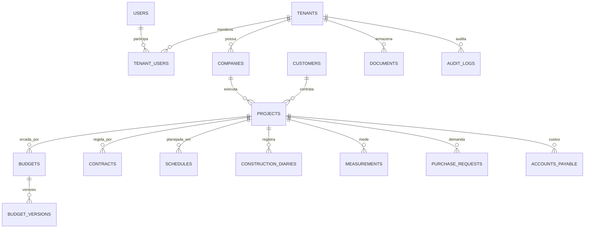

## 1. SaaS e multi-tenancy

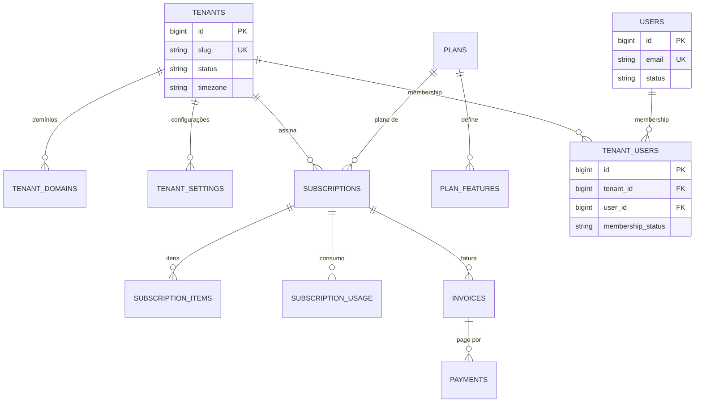

`TENANT_USERS` tem `UNIQUE (tenant_id, user_id)`. `USERS` **não** possui `tenant_id`.

## 2. Usuários e permissões

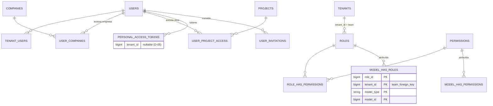

### 2.1 Fase 1 — modelo definitivo (FKs compostas)

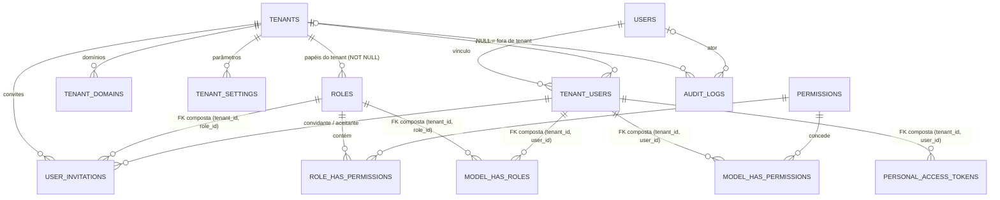

Substitui, para a Fase 1, o diagrama da seção anterior. Detalhes e validação: [FASE1_MODELO.md](FASE1_MODELO.md).

## 3. Empresas e obras

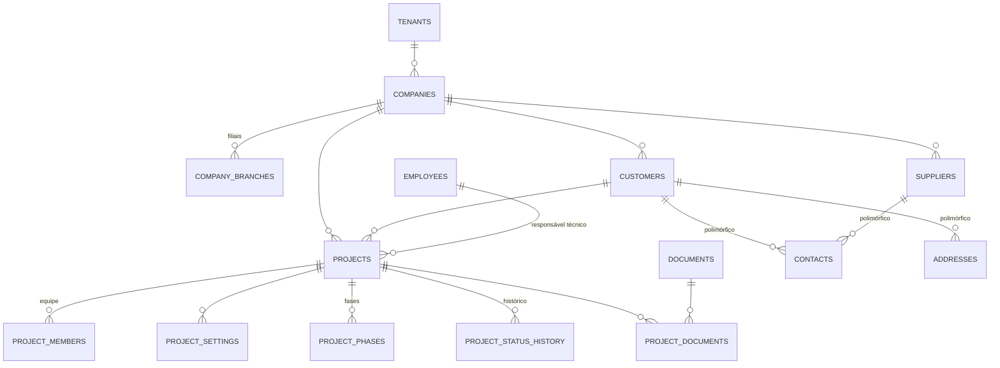

## 4. Contratos

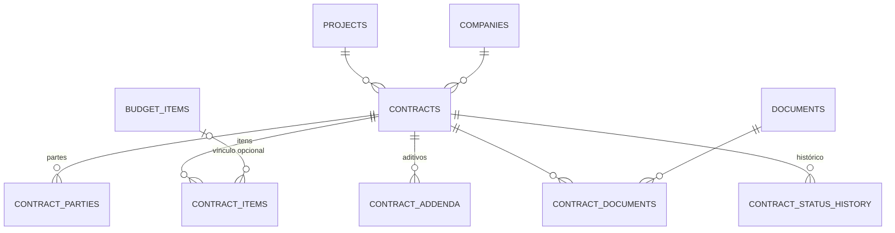

## 5. Orçamentos e composições

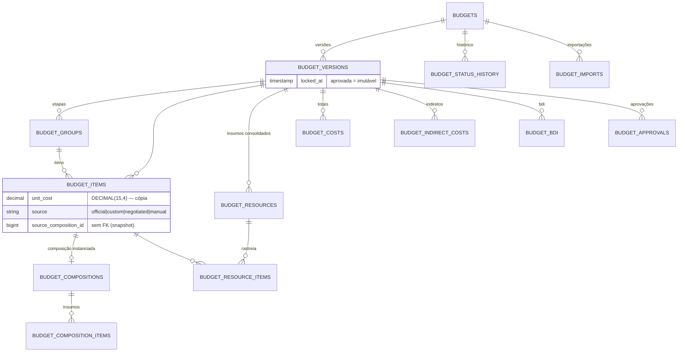

Itens e insumos **copiam** código/descrição/unidade/coeficiente/preço (snapshot). `source_*_id` aponta para a referência apenas como rastreabilidade, **sem FK**.

## 6. Referências técnicas

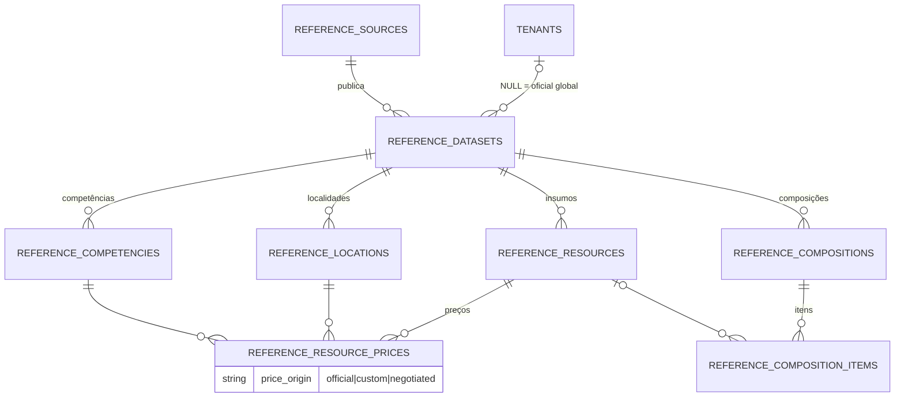

## 7. Planejamento e diário de obras

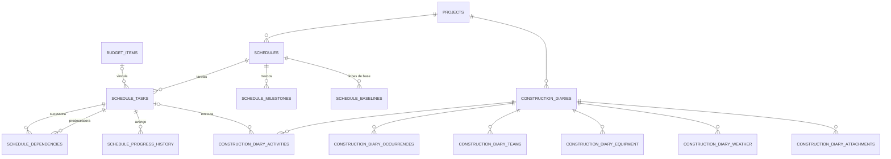

## 8. Medições

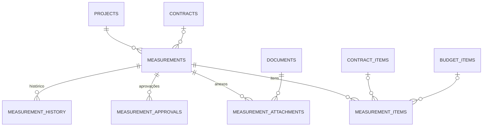

## 9. Financeiro

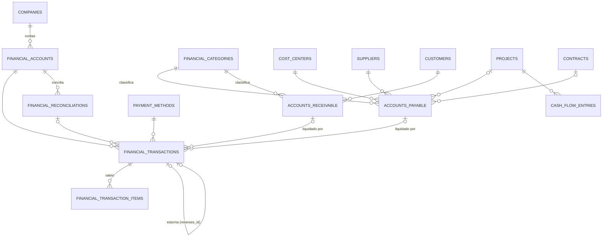

## 10. Compras e estoque

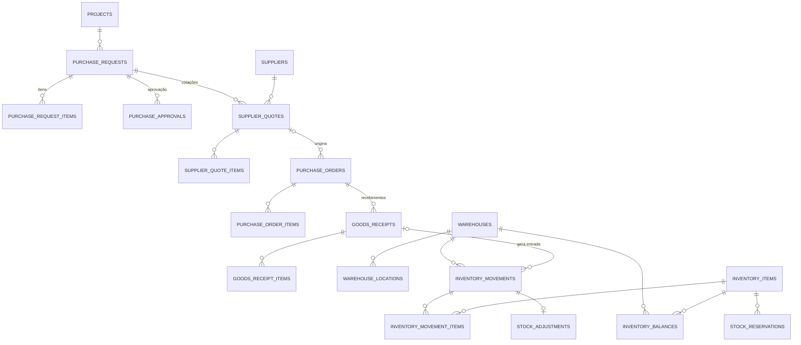

## 11. Equipes e equipamentos

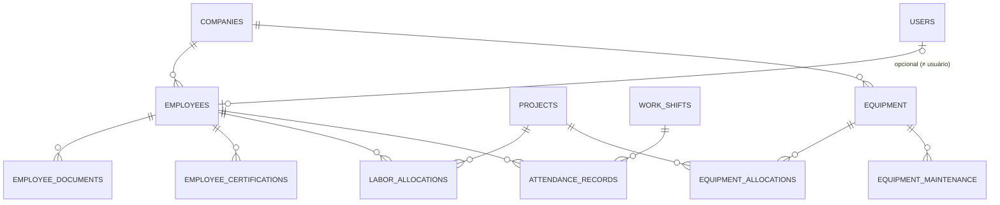

## 12. Documentos e auditoria

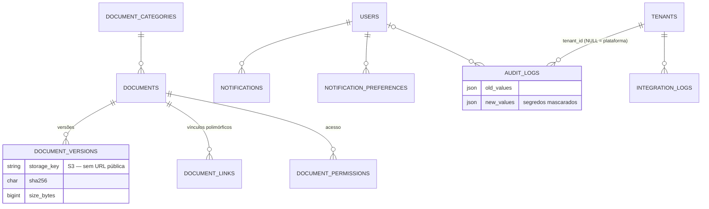

## 13. Inteligência artificial

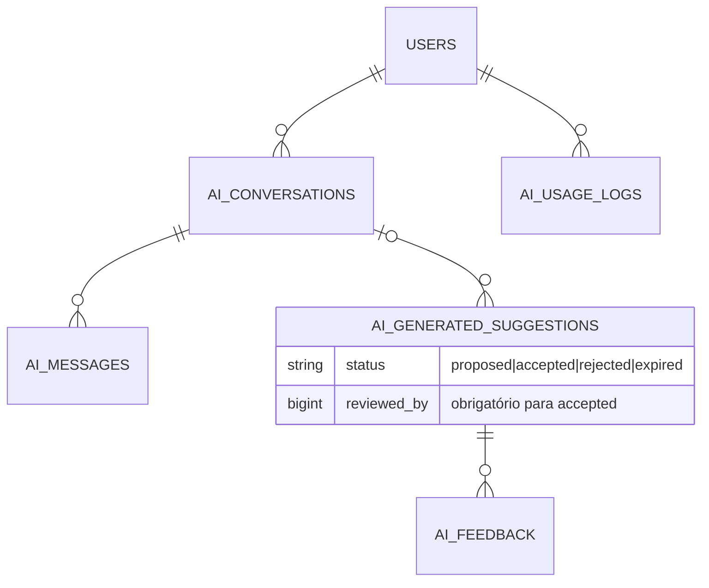
