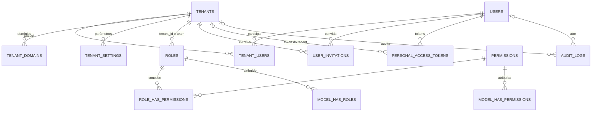

# FASE 1 — DECISÕES PENDENTES D-P01, D-P02 E D-P03 E MODELAGEM PROPOSTA

> **Status: SUPERADO — registro histórico.** As decisões foram tomadas (D-P01 aprovada; D-P02/D-P03 adiadas para a Fase 4) e o modelo foi revisado: a referência atual é **[FASE1_MODELO.md](FASE1_MODELO.md)**. Divergências em relação a este texto: o vínculo `invited` foi removido, `role_name` virou `role_id` com FK composta, e o billing passou para a **Fase 10**.
> Nada foi implementado: nenhuma migration criada ou executada, nenhum banco do Laragon modificado.
> Base: [DATABASE.md](DATABASE.md) · [DB_DECISIONS.md](DB_DECISIONS.md) · [MULTITENANCY.md](MULTITENANCY.md) · [DB_MIGRATION_PLAN.md](DB_MIGRATION_PLAN.md)

## Resumo executivo

| Decisão | Pergunta | Recomendação | Bloqueia a Fase 1? |
|---|---|---|---|
| **D-P01** | Como o tenant ativo é determinado? | **Híbrido:** sessão no servidor com seleção explícita (SPA) + token Sanctum vinculado ao tenant (API). Subdomínio só como dica, sempre revalidada | **Sim** — define middleware, sessão e `personal_access_tokens` |
| **D-P02** | Como calcular BDI e custos indiretos? | **BDI por componentes com escopo (global → grupo → item), cálculo em serviço puro**; indiretos como linhas separadas. Fórmula exata a confirmar com você | **Não** — afeta a Fase 4 (orçamentos) |
| **D-P03** | Quais regimes de encargos sociais? | **Enum extensível por orçamento/versão** que seleciona a variante de preço da base; sem cálculo próprio de encargos no MVP | **Não** — afeta as Fases 4 e 5 |

Só a **D-P01** precisa de resposta para liberar a Fase 1. D-P02 e D-P03 podem ser decididas até o início da Fase 4; apresento as duas agora porque você pediu e porque elas sugerem **dois ajustes pequenos no modelo** (§D-P02 e §D-P03) que prefiro aprovar antes de congelar o `DATABASE.md`.

---

## D-P01 — Resolução do tenant ativo

### 1. Problema
Um usuário é global e pode pertencer a vários tenants (`tenant_users`). A cada requisição o backend precisa saber **qual tenant está ativo**, sem confiar no que o cliente envia, porque dessa resposta dependem o escopo de consulta, as permissões (Spatie Teams) e o isolamento de dados.

### 2. Alternativas e comparação

| | A. Seleção explícita + sessão no servidor | B. Subdomínio por tenant | C. Header `X-Tenant` | D. Token vinculado ao tenant |
|---|---|---|---|---|
| Como funciona | Após o login, o usuário escolhe o tenant; o servidor grava `active_tenant_id` na sessão | `acme.obraflow.com` identifica o tenant pelo host (`tenant_domains`) | O cliente envia o identificador em cada chamada | O token é emitido para um tenant e só vale nele |
| **Vantagens** | Simples; o estado fica no servidor, não forjável; trocar de tenant é uma ação auditável | Contexto óbvio na URL; ótimo para marca própria e para suporte; isola cookies/origem por tenant | Trivial de implementar; stateless | Seguro por construção para integrações; escopo do token é imutável |
| **Desvantagens** | Estado de sessão (Redis) por usuário; duas abas com tenants diferentes se atrapalham (a sessão é uma só) | DNS/TLS wildcard, CORS e cookies por subdomínio; mais infraestrutura; ainda exige revalidar membership | **O cliente escolhe o tenant** — viola a regra "nunca confiar no frontend" se for a única fonte; só é aceitável se **sempre** validado contra `tenant_users` | Não serve para o SPA com cookie; exige reemitir token ao trocar de tenant |
| Risco principal | Vazamento por aba antiga com contexto trocado | Usuário em subdomínio de tenant ao qual não pertence (mitigado por validação) | Esquecer a validação em uma rota | Token emitido sem `tenant_id` (mitigado por coluna) |

### 3. Recomendação técnica
**Híbrido A + D, com B como conveniência opcional:**
- **SPA:** `POST /api/v1/session/tenant {tenant_uuid}` valida `tenant_users.membership_status = active` e grava o tenant na **sessão do servidor**. Se o usuário só tem um tenant, a seleção é automática.
- **API/integrações:** `personal_access_tokens.tenant_id` fixa o tenant; o token não opera outro.
- **Subdomínio (B):** apenas pré-seleciona o tenant; **nunca** substitui a validação de membership. Pode entrar depois, sem mudar o schema.
- **Header `X-Tenant` (C): rejeitado** como fonte de verdade.

### 4. Impactos no banco de dados
- `tenant_users` (já modelada) é a fonte de verdade: `UNIQUE (tenant_id, user_id)`.
- `personal_access_tokens` **+ `tenant_id` NULL** (coluna extra sobre a tabela do pacote).
- `tenant_domains` (já modelada) só é consultada se B for adotada; pode ser criada e ficar sem uso.
- Opcional: `tenant_users.last_used_at` para pré-selecionar o último tenant usado.
- Sem impacto nas tabelas de negócio.

### 5. Impactos no Laravel e no Eloquent
- Middleware `SetTenantContext` após `auth:sanctum`: resolve tenant → valida membership → registra `TenantContext` (singleton por requisição) → `setPermissionsTeamId()`.
- Trait `BelongsToTenant` (escopo global, `creating` preenche, `updating` proíbe mudar `tenant_id`); `tenant_id` fora de `$fillable`.
- Sessão em Redis (`SESSION_DRIVER=redis`, já configurado) e `SANCTUM_STATEFUL_DOMAINS` para o domínio do SPA.
- Se B for adotada: `SESSION_DOMAIN` com ponto inicial compartilha o cookie entre subdomínios; isso amplia o alcance de um XSS/CSRF em um subdomínio e exige `SANCTUM_STATEFUL_DOMAINS` por padrão curinga. **É a principal razão para B ficar opcional.**
- *Route model binding* sempre dentro do escopo do tenant.
- Fila: `Queue::createPayloadUsing` acrescenta `tenant_id`; middleware de job restaura contexto (ver MULTITENANCY.md §4).

### 6. Impactos na arquitetura multi-tenant
É a decisão que **ativa** todo o isolamento: sem contexto resolvido, o escopo global lança exceção (falha fechada). Define também como o Spatie sabe o "team". Erros aqui são os mais graves do produto (vazamento entre clientes), por isso os testes de acesso cruzado e de troca de tenant fazem parte da entrega.

### 7. Consequências de mudar depois

| Mudança | Custo |
|---|---|
| Acrescentar subdomínio (B) | **Baixo** — só middleware + DNS/TLS; schema já existe |
| Trocar de sessão para outro mecanismo | **Médio** — reescreve o middleware e testes; schema igual |
| Mudar o modelo de token | **Médio** — reemitir tokens; `tenant_id` já existe |
| Migrar de "usuário global" para "usuário por tenant" | **Muito alto** — mexe em `users`, e-mail único, FKs `*_by`, Spatie. Por isso D-02 é a decisão que precisa estar certa **agora** |

---

## D-P02 — BDI e custos indiretos

### 1. Problema
É preciso transformar **custo direto** em **preço de venda**. Há duas questões: (a) como o **BDI** (benefícios e despesas indiretas) é composto e calculado; (b) onde ficam os **custos indiretos** (administração local, canteiro, mobilização) — dentro do custo direto como itens ou dentro do BDI. A escolha muda totais, auditoria e a estrutura de `budget_bdi` e `budget_indirect_costs`.

### 2. Alternativas e comparação

| | A. Percentual único global | B. BDI por componentes (fórmula) | C. BDI diferenciado por grupo/item | D. Indiretos como linhas do orçamento |
|---|---|---|---|---|
| Como funciona | `preço = custo × (1 + BDI%)` com um BDI para toda a versão | O BDI é calculado de componentes: administração central, seguro, risco, garantia, despesas financeiras, lucro e tributos | O percentual (ou os componentes) varia por etapa ou item, p.ex. materiais ≠ serviços | Administração local e canteiro viram itens orçados, fora do BDI |
| **Vantagens** | Simplicidade; rápido de entender e auditar | Transparente e defensável; aceito em orçamentos de obra pública; reflete a realidade tributária | Reproduz a prática de mercado e as telas de referência (BDI por linha); permite BDI menor em materiais | Evita dupla contagem; custo visível e quantificável por obra |
| **Desvantagens** | Não reflete diferenças reais; difícil defender em licitação | Exige definir a fórmula e as bases; mais campos e validação | Mais complexo de calcular, explicar e testar; risco de inconsistência entre níveis | Exige disciplina para não repetir o mesmo custo no BDI |

Fórmula usual em obras públicas no Brasil (**a confirmar com você e com a contabilidade; não é regra do sistema**):

```text
BDI = ((1 + AC + S + R + G) × (1 + DF) × (1 + L)) / (1 − I) − 1
AC administração central · S seguro · R risco · G garantia · DF despesas financeiras · L lucro · I tributos sobre o preço
```

### 3. Recomendação técnica
**B + C + D combinados, em camadas:**
1. Dois **modos** de BDI: `percent` (valor digitado) e `components` (calculado pela fórmula acima).
2. **Escopo** com precedência `item > grupo > global`; o percentual **efetivo** é resolvido e **copiado** para cada item (`budget_items.bdi_percent`), coerente com o princípio de snapshot (D-08).
3. **Custos indiretos como linhas separadas** (`budget_indirect_costs`), tratados como custo, **não** dentro do BDI, para evitar dupla contagem.
4. Cálculo em um **serviço puro e testado** (`BdiCalculator`), nunca em controller nem em trigger.
5. **Ordem fixa** documentada: `custo direto → + indiretos → × (1 + BDI) → − desconto`. Hoje o protótipo aplica desconto depois do BDI; é uma hipótese de demonstração, não uma decisão.

### 4. Impactos no banco de dados
- **Ajuste proposto ao DATABASE.md:** em `budget_bdi`, trocar `scope enum + scope_id` (polimórfico, sem FK) por `group_id NULL` e `item_id NULL`, ambos com **FK composta** `(tenant_id, …)`, mais `CHECK` para no máximo um preenchido. Mantém o isolamento garantido pelo banco, o que o `scope_id` genérico não garante.
- `budget_bdi`: `budget_version_id`, `mode`, `components json`, `percent pct`, `group_id`, `item_id`.
- `budget_items.bdi_percent`, `discount_percent` = **valores resolvidos** (snapshot).
- `budget_versions.totals_snapshot` guarda os totais no momento da aprovação.
- Opcional: `bdi_profiles` (modelo de BDI padrão por tenant) — **tabela nova**, só se você quiser reuso entre orçamentos.
- Precisão: o percentual persistido é `DECIMAL(9,4)`; o cálculo intermediário usa `bcmath` com escala maior e arredonda **uma vez** para 4 casas, e o total da linha a 2 casas (D-07).

### 5. Impactos no Laravel e no Eloquent
- `App\Modules\Budgets\Services\BdiCalculator` (puro, sem I/O) + objetos de valor para componentes; testes unitários com casos numéricos.
- *Cast* de `components` para um DTO tipado; validação por Form Request (cada componente ≥ 0; `I < 100`).
- `PHP backed enum` para `mode`.
- Recalcular totais em *Action* transacional; versão aprovada bloqueia edição (`locked_at`).
- Nenhuma regra no model além de *accessors* de leitura.

### 6. Impactos na arquitetura multi-tenant
Os dados são do tenant (`tenant_id` + FKs compostas). A **fórmula** é código global, mas o **perfil/valores** são por tenant. Se `bdi_profiles` existir, é tabela operacional isolada normalmente. Nenhum dado de BDI é compartilhado entre tenants.

### 7. Consequências de mudar depois
- Versões **aprovadas são imutáveis** (snapshot): mudar a metodologia **não** altera orçamentos já aprovados — esse é o principal seguro.
- Mudar depois afeta apenas **rascunhos**: recalcular com a nova regra.
- Mudar a **estrutura** (p.ex. JSON → colunas) exige migração de dados só dos rascunhos e de `budget_bdi`.
- Se a fórmula errada for liberada para produção e aprovada, será preciso **nova versão** para corrigir — por isso recomendo definir a fórmula **antes** da Fase 4 e validar com um caso real calculado manualmente.

### Perguntas que preciso que você responda
1. Usaremos a fórmula acima (componentes) ou só percentual?
2. O BDI pode variar por grupo/item, ou só global?
3. O desconto incide antes ou depois do BDI?
4. Administração local entra como **linha de custo** ou dentro do BDI?
5. Quer perfis de BDI reutilizáveis por tenant?

---

## D-P03 — Regimes de encargos sociais

### 1. Problema
O custo da **mão de obra** depende dos encargos sociais. Bases técnicas, como o SINAPI, publicam preços de mão de obra em **regimes distintos** (com e sem desoneração da folha). O orçamento precisa registrar **qual regime** foi usado, escolher o preço certo na base e preservar essa informação mesmo que a base ou a legislação mudem. O regime aplicável depende da legislação vigente e do enquadramento da empresa — **deve ser validado com a contabilidade**.

### 2. Alternativas e comparação

| | A. Enum por orçamento | B. Percentuais explícitos | C. Regime por competência/item | D. Híbrido (A agora, B depois) |
|---|---|---|---|---|
| Como funciona | O usuário escolhe o regime; ele seleciona a variante de preço da base (encargos já embutidos) | O sistema guarda alíquotas e calcula encargos sobre o salário-hora | O regime muda por mês ou por item | A é o padrão; B só para preços personalizados |
| **Vantagens** | Simples; fiel à base oficial; auditável | Flexível; serve a bases próprias; transparente | Máxima fidelidade | Entrega rápida sem fechar a porta |
| **Desvantagens** | Não calcula encargos próprios | Complexo: exige modelar alíquotas, vigências e regras trabalhistas — risco jurídico | Muito complexo; quase sem uso real | Mantém dois caminhos no longo prazo |

### 3. Recomendação técnica
**Alternativa D.** No MVP, **A**: três valores — `with_relief`, `without_relief`, `not_applicable` — escolhendo a variante de preço oficial. **Sem cálculo próprio de encargos** agora. O enum é guardado como `VARCHAR` mapeado para *PHP enum* (não `ENUM` do MySQL), para acrescentar regimes sem `ALTER TABLE`.

**Ajuste proposto ao modelo:** guardar o regime também em `budget_versions` (valor efetivo e imutável após aprovação); `budgets` guarda o padrão. Hoje só `budgets` tem a coluna, o que deixaria uma versão aprovada sujeita a mudança.

### 4. Impactos no banco de dados
- `budgets.social_charges_regime` (padrão) **+** `budget_versions.social_charges_regime` (efetivo).
- Já existem `reference_datasets.charges_regime` e `reference_resource_prices.is_charges_included`.
- Regra de compatibilidade **na aplicação**: se `mode = reference`, o regime do orçamento deve coincidir com o do dataset (um `CHECK` não alcança outra tabela).
- Se B vier depois: novas tabelas `labor_charge_profiles` (+ vigência) e FK opcional nas linhas de mão de obra; as colunas atuais permanecem.

### 5. Impactos no Laravel e no Eloquent
- `enum SocialChargesRegime: string` + *cast* nos models.
- Regra de validação cruzando orçamento × dataset.
- `ReferencePriceResolver` escolhe o preço por `(competência, localidade, regime)`; se não houver preço no regime pedido, **falha explicitamente** — nunca cai para outro regime em silêncio.
- Lista de regimes em um único lugar (enum), usada por Form Request, API Resource e frontend.

### 6. Impactos na arquitetura multi-tenant
O regime é dado do orçamento (por tenant). As bases oficiais são globais (`tenant_id NULL`); bases próprias do tenant podem declarar o próprio regime. O resolvedor filtra `tenant_id IS NULL OR tenant_id = :tenant`.

### 7. Consequências de mudar depois
- **Acrescentar um regime:** baixo custo (enum + dados), graças ao `VARCHAR`.
- **Trocar o regime de um orçamento existente:** muda preços ⇒ exige **nova versão**; versões aprovadas permanecem intactas.
- **Migrar de A para B:** médio — novas tabelas e UI; orçamentos antigos continuam válidos porque guardam o preço copiado.
- **Mudança legal:** novas bases publicadas em novos datasets; orçamentos antigos não são afetados.

### Perguntas que preciso que você responda
1. Os três valores atendem (com desoneração, sem desoneração, não se aplica)?
2. O regime é escolhido **por orçamento** e pode mudar entre versões?
3. Haverá bases próprias de preço (para as quais B poderia importar)?
4. Confirmar com a contabilidade a nomenclatura a exibir ao usuário.

---

## Modelagem proposta — Fase 1

**Objetivo:** identidade, tenancy e acesso. Nenhum módulo de negócio.

### O que **entra** (14 tabelas)

| # | Tabela | Origem |
|---|---|---|
| 1 | `users` | própria — **global, sem `tenant_id`** |
| 2 | `password_reset_tokens` | padrão Laravel |
| 3 | `tenants` | própria |
| 4 | `tenant_users` | própria |
| 5 | `tenant_domains` | própria (pode ficar sem uso até D-P01-B) |
| 6 | `tenant_settings` | própria |
| 7 | `permissions` | Spatie |
| 8 | `roles` | Spatie (Teams) |
| 9 | `model_has_permissions` | Spatie (Teams) |
| 10 | `model_has_roles` | Spatie (Teams) |
| 11 | `role_has_permissions` | Spatie |
| 12 | `personal_access_tokens` | Sanctum **+ `tenant_id`** |
| 13 | `user_invitations` | própria |
| 14 | `failed_jobs` | padrão Laravel |
| (+) | `audit_logs` | própria — **recomendo incluir**: o AGENTS.md exige auditar alterações de permissões, e elas passam a existir já nesta fase |

Com `audit_logs` são **15 tabelas**. Cache, fila e sessão usam Redis (sem tabelas).

### O que **sai** da Fase 1 em relação ao plano original
`plans`, `plan_features`, `subscriptions`, `subscription_items`, `subscription_usage`, `invoices`, `payments` e `units_of_measure`. Recomendo **adiar a cobrança** para a Fase 12: nenhum recurso da Fase 1 depende de plano ou assinatura, e modelá-la agora cria tabelas sem uso. `units_of_measure` entra na Fase 4 (primeiro uso: orçamentos).

### Campos principais, chaves e relacionamentos

| Tabela | Campos principais | Chaves e restrições |
|---|---|---|
| `users` | `id`, `uuid`, `name`, `email`, `email_verified_at`, `password`, `status`, `last_login_at`, `remember_token` | `UNIQUE(email)`, `UNIQUE(uuid)` |
| `tenants` | `id`, `uuid`, `name`, `slug`, `legal_name`, `document_number`, `email`, `phone`, `status`, `timezone`, `locale`, `deleted_at` | `UNIQUE(slug)`, `UNIQUE(uuid)` |
| `tenant_users` | `id`, `tenant_id`, `user_id`, `membership_status`, `joined_at`, `last_used_at` | FK `tenant_id→tenants`, FK `user_id→users`, **`UNIQUE(tenant_id, user_id)`**, índice `(user_id, membership_status)` |
| `tenant_domains` | `id`, `tenant_id`, `domain`, `is_primary`, `verified_at` | FK `tenant_id→tenants`, `UNIQUE(domain)` |
| `tenant_settings` | `id`, `tenant_id`, `key`, `value (json)` | FK `tenant_id→tenants`, `UNIQUE(tenant_id, key)` |
| `permissions` | `id`, `name`, `guard_name`, `module` | `UNIQUE(name, guard_name)` — catálogo global |
| `roles` | `id`, `tenant_id NULL`, `name`, `guard_name` | FK `tenant_id→tenants` (adicionada à mão), `UNIQUE(tenant_id, name, guard_name)` |
| `model_has_roles` | `role_id`, `model_type`, `model_id`, `tenant_id` | PK `(tenant_id, role_id, model_id, model_type)`, FK `role_id→roles`, FK `tenant_id→tenants` |
| `model_has_permissions` | `permission_id`, `model_type`, `model_id`, `tenant_id` | PK análoga |
| `role_has_permissions` | `permission_id`, `role_id` | PK `(permission_id, role_id)` |
| `personal_access_tokens` | campos do Sanctum + `tenant_id NULL` | FK `tenant_id→tenants`, `UNIQUE(token)` |
| `user_invitations` | `id`, `tenant_id`, `email`, `invited_by`, `role_name`, `token_hash`, `expires_at`, `accepted_at`, `status` | FK `tenant_id→tenants`, FK `invited_by→users`, `UNIQUE(token_hash)` |
| `audit_logs` | `id`, `uuid`, `tenant_id NULL`, `user_id NULL`, `event`, `entity_type`, `entity_id`, `old_values`, `new_values`, `ip_address`, `user_agent`, `request_id`, `created_at` | índices `(tenant_id, entity_type, entity_id)`, `(tenant_id, created_at)`; **sem `updated_at`**; append-only |

### Diagrama



### Pontos de atenção técnicos desta fase

1. **NULL em `roles.tenant_id`:** no MySQL, `UNIQUE` aceita vários `NULL`, então um papel **global** poderia ser duplicado. Mitigação: validar na aplicação ou usar coluna gerada (`COALESCE(tenant_id, 0)`) na unicidade. Preciso da sua preferência.
2. **Spatie não cria FK** para `tenants`; adiciono manualmente.
3. **Cache de permissões:** o Spatie guarda permissões em cache; com Teams, o contexto deve ser definido **antes** de cada checagem, inclusive em jobs.
4. **`email` único global** (D-P04): pessoa com o mesmo e-mail em dois tenants usa a mesma conta; convites entram por `tenant_users`.
5. **Auditoria de `users`:** `users` não tem tenant; eventos de login podem ter `tenant_id NULL` ou o tenant ativo.
6. **MySQL 8.0.30 (Laragon) × 8.4 (Docker):** as migrations devem rodar nas duas versões.

### Entregáveis da Fase 1 (após aprovação)

- 15 migrations, com `down()`, nas duas versões do MySQL.
- Autenticação Sanctum (login, logout, usuário atual) e seleção de tenant conforme D-P01.
- Middleware `SetTenantContext`, `TenantContext`, trait `BelongsToTenant`, regra de validação escopada ao tenant.
- Papéis e permissões iniciais por tenant (Spatie Teams).
- Seeders **apenas de desenvolvimento** (dois tenants fictícios e usuários demo).
- Testes: autenticação; membership suspenso → 403; usuário em dois tenants com permissões diferentes; acesso cruzado → 404; `tenant_id` forjado ignorado; falha fechada sem contexto; FKs e `UNIQUE` rejeitam violações; auditoria registra mudança de permissão.
- Atualização de `API.md`, `DATABASE.md` e `DECISIONS.md`.

### O que **não** entra
Empresas, clientes, obras, orçamentos, finanças, billing, documentos, IA, interface de login no frontend.

---

## Como aprovar

Responda apenas com o que quiser alterar. Sugestão de formato:

```text
D-P01: aprovada como recomendada | alterar para ...
D-P02: decidir na Fase 4 | respostas às 5 perguntas ...
D-P03: decidir na Fase 4 | respostas às 4 perguntas ...
Ajustes ao DATABASE.md (budget_bdi com FKs de grupo/item; regime em budget_versions): aprovados | não
Escopo da Fase 1: 15 tabelas, sem billing: aprovado | alterar
roles.tenant_id NULL: validar na aplicação | coluna gerada
```

Sem aprovação expressa **nada será implementado**.
