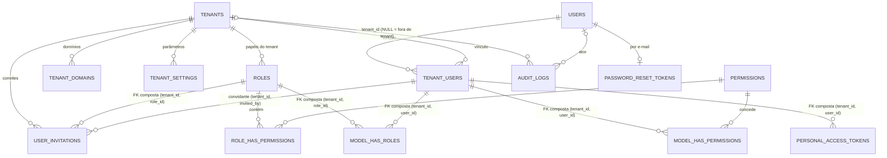

# FASE 1 — MODELO DEFINITIVO (identidade, tenancy e acesso)

> **Status: IMPLEMENTADO** (aprovação formal da Fase 1). Modelo validado em MySQL 8.0.30 (87/87 no protótipo, §7.1) e depois como migrations reais (180 testes de backend). MySQL 8.4 **pendente** no CI. O checklist do §9 foi integralmente aprovado; as pendências da implementação estão em [FASE1_RELATORIO.md](FASE1_RELATORIO.md).
> Nenhuma migration criada ou executada; **nenhum comando de alteração no banco do Laragon** (a validação usou uma instância descartável, já apagada); autenticação **não** implementada.
> Fonte autoritativa das 15 tabelas da Fase 1. Os demais documentos ([DATABASE.md](DATABASE.md), [DB_CONSTRAINTS.md](DB_CONSTRAINTS.md), [MULTITENANCY.md](MULTITENANCY.md), [DB_MIGRATION_PLAN.md](DB_MIGRATION_PLAN.md)) apontam para cá.

## 1. Decisões incorporadas

| Decisão | Resultado |
|---|---|
| **D-P01** tenant ativo | **Aprovada** — híbrido: SPA com sessão no servidor e seleção explícita; API/integrações com token Sanctum **obrigatoriamente** vinculado ao tenant; subdomínio só como pré-seleção futura; `X-Tenant` **nunca** é autoridade; **toda requisição** revalida o vínculo ativo; troca de tenant é auditada |
| **D-P02** BDI/indiretos | **Adiada para a Fase 4.** Mantida a recomendação (componentes + percentual informado; escopo global/grupo/item; indiretos como linhas separadas). Fórmula e incidência do desconto **não aprovadas** |
| **D-P03** encargos | **Adiada para a Fase 4.** Mantidos `with_relief`, `without_relief`, `not_applicable`, persistidos nas **versões** de orçamento; **sem cálculo próprio** de encargos no MVP |
| Escopo | **15 tabelas**, com `audit_logs`; **sem** billing, assinaturas, empresas, obras ou módulos de negócio |

Correções obrigatórias do revisor, e onde foram resolvidas:

| # | Correção | Solução |
|---|---|---|
| 1 | Integridade do Spatie Teams | FK composta `(tenant_id, role_id) → roles(tenant_id, id)` em `model_has_roles` (substitui a FK simples do pacote) + FK composta do usuário para `tenant_users` (§3.9–3.11) |
| 2 | Sem papéis globais | `roles.tenant_id NOT NULL`; unicidade `(tenant_id, name, guard_name)` sem `NULL` (§3.8) |
| 3 | Token com tenant obrigatório | `personal_access_tokens.tenant_id` + regra de borda: token sem tenant **não** acessa dados de negócio (§5) |
| 4 | Auditoria completa | Catálogo de eventos de login, logout, seleção de tenant, convites, vínculos, papéis, permissões e tokens (§6) |
| 5 | Documentação | Lista em [DECISIONS.md](DECISIONS.md) e no relatório da tarefa |
| 6 | Compatibilidade MySQL Laragon | §7 |

## 2. Visão geral

`failed_jobs` não tem relações.

## 3. As 15 tabelas

Convenções: `BIGINT UNSIGNED` para ids/FKs; `TIMESTAMP` em UTC; `VARCHAR`+`CHECK` em vez de `ENUM` do MySQL (evolui sem `ALTER`); todo status tem enum PHP equivalente. `FK` sempre `ON DELETE RESTRICT ON UPDATE RESTRICT`, salvo indicação.

### 3.1 `users` — identidade global (**sem `tenant_id`**)

| Coluna | Tipo | Regra |
|---|---|---|
| `id` | BIGINT UNSIGNED AI | PK |
| `uuid` | CHAR(36) | NOT NULL, UNIQUE |
| `name` | VARCHAR(150) | NOT NULL |
| `email` | VARCHAR(190) | NOT NULL, **UNIQUE**; `COLLATE utf8mb4_0900_as_ci` (sem diferenciar caixa, **diferenciando acento**); normalizado em minúsculas na aplicação |
| `email_verified_at` | TIMESTAMP | NULL |
| `password` | VARCHAR(255) | NOT NULL (hash) |
| `status` | VARCHAR(20) | NOT NULL, default `active`; `CHECK IN ('active','blocked')` |
| `last_login_at` | TIMESTAMP | NULL |
| `remember_token` | VARCHAR(100) | NULL |
| `created_at`, `updated_at` | TIMESTAMP | NULL (padrão Laravel) |

Sem soft delete. Bloqueio = `status = blocked` (revoga sessões e tokens; auditado).

### 3.2 `password_reset_tokens`

`email VARCHAR(190)` **PK**, `token VARCHAR(255)` (hash), `created_at TIMESTAMP NULL`. Sem FK (e-mail pode ser de conta inexistente; evita enumeração).

### 3.3 `tenants`

| Coluna | Tipo | Regra |
|---|---|---|
| `id` | BIGINT UNSIGNED AI | PK |
| `uuid` | CHAR(36) | NOT NULL, UNIQUE |
| `name` | VARCHAR(150) | NOT NULL |
| `slug` | VARCHAR(80) | NOT NULL, UNIQUE (slug de tenant removido continua **reservado**) |
| `legal_name` | VARCHAR(200) | NULL |
| `document_number` | VARCHAR(20) | NULL |
| `email` | VARCHAR(190) | NULL |
| `phone` | VARCHAR(30) | NULL |
| `status` | VARCHAR(20) | NOT NULL, default `active`; `CHECK IN ('trial','active','suspended','canceled')` |
| `timezone` | VARCHAR(64) | NOT NULL, default `America/Sao_Paulo` |
| `locale` | VARCHAR(10) | NOT NULL, default `pt_BR` |
| `created_at`, `updated_at`, `deleted_at` | TIMESTAMP | NULL (soft delete) |

Sem cobrança nesta fase: `trial` é apenas um valor reservado.

### 3.4 `tenant_users` — vínculo usuário ↔ tenant

| Coluna | Tipo | Regra |
|---|---|---|
| `id` | BIGINT UNSIGNED AI | PK |
| `tenant_id` | BIGINT UNSIGNED | NOT NULL, FK → `tenants(id)` |
| `user_id` | BIGINT UNSIGNED | NOT NULL, FK → `users(id)` |
| `membership_status` | VARCHAR(20) | NOT NULL, default `active`; `CHECK IN ('active','suspended','removed')` |
| `joined_at` | TIMESTAMP | NULL |
| `last_used_at` | TIMESTAMP | NULL (pré-seleção do último tenant) |
| `created_at`, `updated_at` | TIMESTAMP | NULL |

- **`UNIQUE (tenant_id, user_id)`** — também é o alvo das FKs compostas das tabelas abaixo.
- Índice `(user_id, membership_status)`.
- O vínculo só nasce na **aceitação do convite** (ou na criação do tenant, para o primeiro administrador). Por isso `invited` **deixou de ser** valor do vínculo: o estado "convidado" vive em `user_invitations`. O vínculo `removed` é mantido para histórico; um novo convite o reativa (sem criar linha nova).
- Regra de aplicação: nunca remover/suspender o **último administrador ativo** do tenant.

### 3.5 `tenant_domains`

`id`; `tenant_id` NOT NULL FK; `domain VARCHAR(190)` NOT NULL **UNIQUE** (minúsculas); `is_primary BOOLEAN` NOT NULL default 0; `primary_marker` coluna **gerada** `IF(is_primary = 1, 1, NULL)` com **`UNIQUE (tenant_id, primary_marker)`** → no máximo um domínio primário por tenant; `verified_at NULL`; timestamps. Sem uso até a adoção de subdomínio.

### 3.6 `tenant_settings`

`id`; `tenant_id` NOT NULL FK; `setting_key VARCHAR(100)` NOT NULL; `setting_value JSON` NOT NULL; timestamps; **`UNIQUE (tenant_id, setting_key)`**. (`key` é palavra reservada do MySQL; usa-se `setting_key`.)

### 3.7 `permissions` — catálogo **global** (Spatie)

`id`; `name VARCHAR(125)`; `guard_name VARCHAR(125)`; `module VARCHAR(60) NULL` (coluna adicional, agrupamento na UI); timestamps; `UNIQUE (name, guard_name)`. Convenção `modulo.acao` (ex.: `members.invite`). O catálogo é **dado de referência** instalado por comando idempotente versionado no código (não é seeder de demonstração).

### 3.8 `roles` — **sempre de um tenant** (Spatie Teams)

| Coluna | Tipo | Regra |
|---|---|---|
| `id` | BIGINT UNSIGNED AI | PK |
| `tenant_id` | BIGINT UNSIGNED | **NOT NULL**, FK → `tenants(id)` (a migration do pacote não cria a FK) |
| `name` | VARCHAR(125) | NOT NULL |
| `guard_name` | VARCHAR(125) | NOT NULL |
| `is_system` | BOOLEAN | NOT NULL default 0 (papéis criados no provisionamento; não podem ser excluídos) |
| `created_at`, `updated_at` | TIMESTAMP | NULL |

- **`UNIQUE (tenant_id, name, guard_name)`** — sem `NULL`, portanto a unicidade é exata.
- **`UNIQUE (tenant_id, id)`** — alvo das FKs compostas.
- Divergência deliberada do stub do pacote: `tenant_id` é `NOT NULL` (o stub o cria `NULL`).
- Sem papéis globais no MVP. **Efeito colateral útil:** se algum código chamar `Role::create()` sem contexto de tenant, o pacote grava `tenant_id = NULL` e o banco **recusa** (falha fechada).

### 3.9 `model_has_roles` — atribuição (Spatie), **com integridade reforçada**

| Coluna | Tipo | Regra |
|---|---|---|
| `tenant_id` | BIGINT UNSIGNED | NOT NULL |
| `role_id` | BIGINT UNSIGNED | NOT NULL |
| `model_type` | VARCHAR(255) | NOT NULL, **`CHECK (model_type = 'user')`** |
| `model_id` | BIGINT UNSIGNED | NOT NULL |

- **PK `(tenant_id, role_id, model_id, model_type)`** (a mesma do pacote com Teams).
- **FK composta `(tenant_id, role_id) → roles(tenant_id, id)`** — o papel **pertence ao mesmo tenant** do vínculo. Substitui a FK simples `role_id → roles.id ... CASCADE` do stub.
- **FK composta `(tenant_id, model_id) → tenant_users(tenant_id, user_id)`** — o usuário **tem vínculo** com esse tenant.
- Índice extra `(tenant_id, model_id)` (suporte à segunda FK); o índice `(model_id, model_type)` do pacote permanece.
- **Pré-requisito:** `Relation::enforceMorphMap(['user' => User::class])` para que `model_type` seja o alias `'user'`. Só `User` recebe papéis no MVP; se outro tipo de modelo precisar, remover o `CHECK` e a 2ª FK e reavaliar (consequência registrada em [DB_DECISIONS.md](DB_DECISIONS.md) D-19).
- A FK não verifica `membership_status = active` (o banco não filtra por valor de coluna sem trigger — ver §7); isso é validado **a cada requisição** (§4) e ao atribuir papel.
- `RESTRICT`: remover atribuição é ação explícita e **auditada**.

### 3.10 `model_has_permissions` — permissões diretas (Spatie)

PK `(tenant_id, permission_id, model_id, model_type)`; `permission_id` FK → `permissions(id)` RESTRICT; **FK composta `(tenant_id, model_id) → tenant_users(tenant_id, user_id)`**; `CHECK (model_type = 'user')`; índice `(tenant_id, model_id)`. **Política:** permissões **diretas não são usadas no MVP** — tudo por papel. A tabela existe porque o pacote a exige, e já nasce com a mesma proteção.

### 3.11 `role_has_permissions`

PK `(permission_id, role_id)`; `permission_id` FK → `permissions(id)`; `role_id` FK → `roles(id)`; ambas **RESTRICT** (o stub usa `CASCADE`; trocar por `RESTRICT` força o desvínculo auditado). Papel (do tenant) × permissão (global): não há risco de cruzamento entre tenants.

### 3.12 `personal_access_tokens` — Sanctum **+ tenant**

Colunas do Sanctum 4.4 (`id`, `tokenable_type`, `tokenable_id`, `name`, `token CHAR(64) UNIQUE`, `abilities`, `last_used_at`, `expires_at`, timestamps) **mais**:

| Coluna | Regra |
|---|---|
| `tenant_id` BIGINT UNSIGNED **NULL** | FK → `tenants(id)` |

- **FK composta `(tenant_id, tokenable_id) → tenant_users(tenant_id, user_id)`** + **`CHECK (tokenable_type = 'user')`**: um token com tenant só pode pertencer a um usuário **vinculado** àquele tenant (com `tenant_id NULL` a FK não é avaliada).
- Índice `(tenant_id, tokenable_id)`.
- `tenant_id NULL` é permitido **somente** para tokens que acessam o grupo `auth/*` (§5); **nunca** dados de negócio.
- Tokens: guardar só o hash (Sanctum já faz); exibir o valor uma única vez.

### 3.13 `user_invitations`

| Coluna | Tipo | Regra |
|---|---|---|
| `id` | BIGINT UNSIGNED AI | PK |
| `tenant_id` | BIGINT UNSIGNED | NOT NULL, FK → `tenants(id)` |
| `email` | VARCHAR(190) | NOT NULL (minúsculas; `as_ci`) |
| `invited_by` | BIGINT UNSIGNED | NOT NULL |
| `role_id` | BIGINT UNSIGNED | NOT NULL |
| `token_hash` | CHAR(64) | NOT NULL, **UNIQUE**, `CHARACTER SET ascii COLLATE ascii_bin` |
| `status` | VARCHAR(20) | NOT NULL default `pending`; `CHECK IN ('pending','accepted','expired','revoked')` |
| `expires_at` | TIMESTAMP | NOT NULL |
| `accepted_at` | TIMESTAMP | NULL |
| `accepted_user_id` | BIGINT UNSIGNED | NULL |
| `revoked_at` | TIMESTAMP | NULL |
| `created_at`, `updated_at` | TIMESTAMP | NULL |
| `pending_email` | VARCHAR(190) | coluna **gerada** `IF(status = 'pending', email, NULL)` |

- **FK composta `(tenant_id, invited_by) → tenant_users(tenant_id, user_id)`** — quem convida pertence ao tenant.
- **FK composta `(tenant_id, role_id) → roles(tenant_id, id)`** — o papel do convite é do mesmo tenant (substitui o antigo `role_name`, que não garantia nada).
- **FK composta `(tenant_id, accepted_user_id) → tenant_users(tenant_id, user_id)`** — preenchida na aceitação.
- **`UNIQUE (tenant_id, pending_email)`** — no máximo **um convite pendente** por e-mail e tenant.
- `CHECK`: `status = 'accepted'` ⇒ `accepted_at` e `accepted_user_id` preenchidos.
- Guarda **hash** do token, nunca o token; expiração obrigatória.

### 3.14 `audit_logs` — trilha **append-only**

| Coluna | Tipo | Regra |
|---|---|---|
| `id` | BIGINT UNSIGNED AI | PK |
| `uuid` | CHAR(36) | NOT NULL, UNIQUE |
| `tenant_id` | BIGINT UNSIGNED | NULL, FK → `tenants(id)` (`NULL` = evento fora de tenant, ex.: tentativa de login) |
| `user_id` | BIGINT UNSIGNED | NULL, FK → `users(id)` (ator; `NULL` se desconhecido) |
| `event` | VARCHAR(60) | NOT NULL (catálogo em §6) |
| `entity_type` | VARCHAR(100) | NULL (alias do *morph map*) |
| `entity_id` | BIGINT UNSIGNED | NULL |
| `old_values` / `new_values` | JSON | NULL (**já sanitizados**) |
| `metadata` | JSON | NULL (ex.: `{"from_tenant_id":1,"to_tenant_id":2}`) |
| `ip_address` | VARBINARY(16) | NULL |
| `user_agent` | VARCHAR(255) | NULL |
| `request_id` | CHAR(36) | NULL |
| `created_at` | TIMESTAMP(6) | NOT NULL, default `CURRENT_TIMESTAMP(6)` |

- **Sem `updated_at`.** Índices `(tenant_id, created_at)`, `(tenant_id, entity_type, entity_id)`, `(user_id, created_at)`, `(event, created_at)`.
- **Imutabilidade:** (a) modelo Eloquent que lança exceção em `update/delete`; (b) em produção, o usuário da aplicação tem **somente** `INSERT`/`SELECT` nesta tabela. **Sem triggers** (ver §7).
- **Nunca gravar:** senha, token, `token_hash`, `remember_token`, códigos de recuperação/MFA. Um `AuditSanitizer` com lista de chaves proibidas é obrigatório, **com testes**.

### 3.15 `failed_jobs`

Padrão do Laravel (`id`, `uuid` UNIQUE, `connection`, `queue`, `payload`, `exception`, `failed_at`). O `payload` pode conter dados pessoais: acesso restrito; sem FK.

## 4. Validação a cada requisição (D-P01)

Middleware `SetTenantContext` (após `auth:sanctum`), **em toda rota de negócio**:

1. Origem do tenant: **sessão do servidor** (SPA) ou **`personal_access_tokens.tenant_id`** (token). Nenhum header/parâmetro/corpo do cliente é autoridade.
2. Sem tenant resolvido ⇒ `403 tenant_required`.
3. Consulta ao vínculo: `tenant_users WHERE tenant_id = ? AND user_id = ? AND membership_status = 'active'`. Ausente/suspenso/removido ⇒ `403 tenant_forbidden`.
4. `tenants.status` deve permitir acesso (`suspended`/`canceled` ⇒ `403 tenant_suspended`).
5. `users.status = 'active'`.
6. Registra `TenantContext`, chama `setPermissionsTeamId($tenant->id)`.
7. **Sem cache** da checagem de vínculo na Fase 1: a consulta usa o índice único `(tenant_id, user_id)` e garante que suspensão/remoção tenham efeito **imediato**. Revisar só com carga medida.

**Troca de tenant (SPA):** `POST /api/v1/session/tenant` valida os itens 3–5 para o **tenant de destino**, grava na sessão, atualiza `tenant_users.last_used_at`, **regenera o identificador da sessão** e registra `tenant.selected` com origem e destino.

### Limitação: contexto compartilhado entre abas

A sessão do servidor guarda **um único tenant ativo por navegador**. Se o usuário trocar de tenant na aba B, a aba A — ainda exibindo o tenant anterior — passa a operar, na requisição seguinte, no **novo** tenant, sem que a tela mostre isso. Os dados continuam isolados e autorizados (o servidor sempre usa o tenant da sessão), mas a **interface fica inconsistente** e o usuário pode agir sobre o tenant errado.

Mitigações propostas (**dependem de aprovação**, §9):
1. O frontend envia `X-Tenant-Hint: <uuid do tenant exibido>`. **Não é autoridade**: o servidor apenas compara com o tenant da sessão e, se divergir, responde `409 tenant_mismatch` **sem executar** a operação; o SPA pede para recarregar.
2. O SPA sincroniza abas com `BroadcastChannel` e recarrega ao detectar troca.
3. Documentar na interface: "trocar de organização afeta todas as abas".

Quem precisa operar vários tenants em paralelo deve usar **tokens** (cada um fixo no seu tenant).

## 5. Tokens e acesso a dados de negócio

| Tipo de requisição | Tenant | Pode acessar negócio? |
|---|---|---|
| SPA (cookie) com tenant selecionado | sessão | Sim |
| SPA (cookie) **sem** tenant selecionado | — | Não — só `auth/*` (listar vínculos, selecionar tenant) |
| Token com `tenant_id` | token | Sim, no **seu** tenant |
| Token **sem** `tenant_id` | — | **Não.** Só `auth/*` (ex.: listar vínculos e **emitir** token para um tenant) |

- `tenant_id` do token é definido **na emissão**, a partir do tenant ativo do emissor, e é **imutável** (revogar e emitir outro).
- A cada uso, os passos 3–5 de §4 são reavaliados: token de usuário suspenso/removido deixa de funcionar na hora. Ao suspender/remover o vínculo (ou bloquear o usuário), a ação **revoga** os tokens daquele tenant e o evento é auditado.
- Política recomendada (**a confirmar**): `expires_at` **obrigatório** na emissão, com validade máxima definida.
- Rotas de negócio ficam atrás de um grupo de middleware único (`tenant.required`); qualquer rota nova nasce nele por padrão.

## 6. Catálogo de auditoria

Eventos de `audit_logs.event` (formato `dominio.acao`). Todo evento grava `request_id`, IP e User-Agent.

| Domínio | Eventos | `tenant_id` | Observações |
|---|---|---|---|
| Autenticação | `auth.login`, `auth.login_failed`, `auth.logout`, `auth.password_reset_requested`, `auth.password_changed` | `NULL` (ou o tenant ativo, se houver) | `login_failed` guarda `metadata.email_hmac` (**HMAC-SHA256** do e-mail; nunca o e-mail em claro nem a senha) e é limitado por *rate limit* |
| Tenant | `tenant.selected`, `tenant.selection_denied`, `tenant.updated`, `tenant.suspended`, `tenant.reactivated` | tenant de destino | `tenant.selected` registra `from_tenant_id` → `to_tenant_id` |
| Convites | `invitation.created`, `invitation.accepted`, `invitation.revoked`, `invitation.expired` | tenant do convite | `expired` é gerado pela rotina agendada (sem ator) |
| Vínculos | `membership.created`, `membership.suspended`, `membership.reactivated`, `membership.removed` | tenant | `entity = tenant_user` |
| Papéis | `role.created`, `role.updated`, `role.deleted`, `role.assigned`, `role.revoked` | tenant | `old_values/new_values` com nome e conjunto de permissões |
| Permissões | `permission.granted`, `permission.revoked` | tenant | Mudanças no conjunto de permissões de um papel (e permissões diretas, se algum dia usadas) |
| Tokens | `token.created`, `token.revoked`, `token.expired_use_denied` | tenant do token | **Nunca** o valor do token |

**Semântica de gravação:**
- Eventos de **autorização e acesso** (tenant, convites, vínculos, papéis, permissões, tokens) são gravados **na mesma transação** da mudança; se a gravação da auditoria falhar, a operação inteira é revertida (falha fechada).
- `auth.login`, `auth.logout` e `auth.login_failed`: tentativa de gravação na requisição; falha gera log de erro e alerta, mas **não** bloqueia a resposta (senão uma falha de auditoria derrubaria o login). *A confirmar no §9.*

## 7. Compatibilidade com o MySQL do Laragon

Verificação **somente leitura** (`SELECT` de variáveis; nenhum DDL/DML) no servidor local:

| Item | Valor encontrado | Consequência |
|---|---|---|
| Versão | **8.0.30** | Suporta tudo abaixo; alvo Docker é 8.4 |
| `sql_mode` | `STRICT_TRANS_TABLES`, `NO_ZERO_DATE`, `ONLY_FULL_GROUP_BY`… | Estrito: bom; consultas agregadas precisam ser corretas |
| Charset/collation do servidor | `utf8mb4` / `utf8mb4_0900_ai_ci` | Igual ao 8.4. `ai_ci` ignora acento: por isso `users.email` usa `utf8mb4_0900_as_ci` |
| Engine / row format | InnoDB / `DYNAMIC` | Índices até 3072 bytes: `UNIQUE (tenant_id, name, guard_name)` com 125+125 caracteres = 1.008 bytes ✓ (mesmo com 255+255 = 2.048 ✓) |
| `time_zone` | **`SYSTEM`** | ⚠️ **Risco:** colunas `TIMESTAMP` são convertidas pelo fuso da sessão. Laravel grava em UTC; se a sessão MySQL estiver no fuso do Windows, os valores ficam deslocados. **Ação antes de qualquer migration:** definir `'timezone' => '+00:00'` na conexão MySQL (`config/database.php`) e manter `--default-time-zone=+00:00` no Docker (já configurado) |
| `log_bin` / `log_bin_trust_function_creators` | **1 / 0** | ⚠️ Com binlog ligado e sem a variável, **só usuário com SUPER cria triggers**. O `root` local pode; um usuário de produção, não. **Decisão: nenhuma trigger na Fase 1** |
| `lower_case_table_names` | 1 (Windows) | Linux/Docker usa 0. Todos os nomes são minúsculos ✓ — nunca criar nomes que difiram só pela caixa |
| `sql_require_primary_key` | 0 | Serviços gerenciados costumam usar 1: **todas** as tabelas têm PK ✓ (inclusive pivôs e `password_reset_tokens`) |
| `foreign_key_checks` | 1 | FKs ativas |
| Plugin de autenticação padrão | `mysql_native_password` | O 8.4 usa `caching_sha2_password`. Criar o usuário da aplicação **explicitamente** com `caching_sha2_password` nos dois ambientes (o `pdo_mysql` do PHP 8.4 suporta) |
| Outros bancos no mesmo servidor | Sim (de outros projetos) | **Nunca** usar `root` na aplicação; usar banco `obraflow` e usuário próprio com privilégios **somente** nele; testes em `obraflow_testing`. Nenhum banco existente é tocado |

Recursos usados pelo modelo × MySQL 8.0.30 / 8.4:

| Recurso | 8.0.30 | 8.4 | Observação |
|---|---|---|---|
| FK composta + `UNIQUE (tenant_id, id)` | ✓ | ✓ | O pai precisa de índice com as colunas referenciadas **nesta ordem** — satisfeito pelos `UNIQUE` |
| `CHECK` aplicado | ✓ (≥ 8.0.16) | ✓ | Não pode usar coluna de FK com ação `CASCADE`/`SET NULL` — todas as FKs são `RESTRICT` |
| Coluna gerada + `UNIQUE` | ✓ | ✓ | `virtualAs` no Laravel |
| `JSON` | ✓ | ✓ | |
| `TIMESTAMP(6)` | ✓ | ✓ | |
| `ascii_bin` / `utf8mb4_0900_as_ci` | ✓ | ✓ | `->charset()/->collation()` no Blueprint |

**Validado na prática:** o comportamento acima foi exercitado numa instância MySQL 8.0.30 descartável (§7.1). **Ainda pendente:** repetir no **8.4** (sem binário nesta máquina) e portar o protótipo para migrations reais com testes no CI nas duas versões.

## 7.1 Validação empírica (MySQL 8.0.30 descartável)

Evidência em [`validacao-fase1/`](validacao-fase1/README.md): DDL protótipo + roteiro + saída. **87 aprovados, 0 reprovados.** O banco do Laragon não foi alterado.

| Área | Resultado |
|---|---|
| Esquema | 15 tabelas criadas sem erro; todas com PK; todas as FKs `RESTRICT`; `roles.tenant_id NOT NULL` |
| Papel × tenant × vínculo | Papel de outro tenant, usuário sem vínculo e usuário de outro tenant são **recusados pelo banco** (erro 1452); `model_type ≠ 'user'` recusado (CHECK 3819); papel sem tenant recusado (1048); excluir papel/vínculo/tenant em uso recusado (1451) |
| Usuário global | Mesma pessoa admin em A e viewer em B funciona |
| Vínculos, usuários, tenants | Duplicidade, status inválido e usuário inexistente recusados; e-mail **case-insensitive** (duplicata recusada) e **accent-sensitive** (`jose` e `josé` coexistem) |
| Domínios e configurações | Um único domínio primário por tenant (coluna gerada + UNIQUE); vários não primários OK; `UNIQUE (tenant, chave)` |
| Tokens | Token com tenant só para usuário vinculado; tenant sem vínculo recusado; token sem tenant aceito pelo banco (a barreira é da aplicação); `tokenable_type ≠ 'user'` recusado |
| Convites | Convidante fora do tenant e papel de outro tenant recusados; **um convite pendente** por e-mail/tenant (inclusive com caixa diferente); revogado não bloqueia novo; `accepted` sem dados recusado (CHECK); `token_hash` em `ascii_bin` |
| Auditoria | `tenant_id NULL` permitido; tenant inexistente recusado; `TIMESTAMP(6)` com microssegundos; sem `updated_at` |
| **R6** triggers e imutabilidade | Usuário **sem SUPER não cria trigger** (erro 1419, `log_bin=1`) — confirma "sem triggers"; com privilégios de produção (INSERT/SELECT) `UPDATE`/`DELETE` em `audit_logs` falham (1142) |
| **R5** fuso | Sessão em `-04:00` **deslocou** um `TIMESTAMP` em 4 h (gravado 12:00, lido 16:00 em UTC); com `time_zone=+00:00` o round-trip é exato |
| Autenticação | Usuário `caching_sha2_password` conecta pelo `pdo_mysql` do PHP 8.4.2 |
| **Spatie 8.5.0 real** | `Role::create` sem contexto falha fechado; papel criado herda o tenant do contexto; papéis e permissões mudam ao trocar de tenant; `assignRole` com objeto de papel de outro tenant → **banco recusa**; por nome → papel **não é encontrado**; usuário sem vínculo → banco recusa; **nenhum** papel global existe |
| **Sanctum 4.4 real** | `createToken` funciona com `enforceMorphMap` (`tokenable_type='user'`, passa no CHECK); vincular o token a tenant sem vínculo é recusado |

### Achados que mudam a implementação

1. **Armadilha de relação em cache (confirmada):** reutilizar o **mesmo objeto de usuário** depois de trocar o tenant do contexto **mantém o papel do tenant anterior**. Em PHP-FPM cada requisição é um processo novo (sem problema), mas em **jobs, testes, Octane ou loops** é preciso recarregar o usuário ou chamar `unsetRelation('roles')`/`unsetRelation('permissions')` após `setPermissionsTeamId`. Vira teste obrigatório e utilitário único (`TenantContext::switchTo()`).
2. **O Sanctum não conhece tenant:** `createToken()` grava `tenant_id = NULL`. A emissão precisa de um **modelo de token próprio** (`Sanctum::usePersonalAccessTokenModel`) ou de uma ação que grave `tenant_id` **na mesma transação**; token sem tenant fica inutilizável para negócio por design.
3. **`guard_name` (R9):** com o `User` real o Spatie resolve `["web"]`; uma subclasse sem guard fixo falhou com `GuardDoesNotMatch`. Mantém-se a regra de fixar `$guard_name = 'web'` no modelo.
4. **Papéis por nome** são resolvidos dentro do tenant do contexto — a primeira barreira; o banco é a segunda.
5. A barreira "vínculo `active`" **não** existe no banco (sem triggers): continua sendo a revalidação a cada requisição (§4).

### Limites da validação

DDL **protótipo** (não são as migrations finais); executado como `root` na instância descartável; **8.4 não testado**; Redis, middleware de tenant, autenticação e `BelongsToTenant` **ainda não existem**, logo não foram exercitados.

## 8. Riscos técnicos remanescentes

| # | Risco | Mitigação / estado |
|---|---|---|
| R1 | FKs compostas e `CHECK` **validados no 8.0.30** (87/87, §7.1); **8.4 ainda não testado** e o protótipo ainda não é migration | Portar para migrations com os mesmos testes; CI com 8.0 e 8.4 |
| R2 | Internos do Spatie: cache de permissões **global** (um registro com permissões e papéis de todos os tenants) e consultas que tratam `tenant_id IS NULL` como papel global | Versão fixada (8.5.0); teste "mesmo usuário, papéis distintos em dois tenants"; teste afirmando que **não existe** papel com `tenant_id NULL`; revisar a cada atualização do pacote |
| R3 | O `CHECK (model_type = 'user')` depende de `enforceMorphMap`; esquecer o *morph map* grava a classe completa e a migration/teste falham | `enforceMorphMap` no `AppServiceProvider`, coberto por teste |
| R4 | **Abas do navegador** compartilham o tenant da sessão | §4: `X-Tenant-Hint` (não autoritativo), `BroadcastChannel`, tokens para uso paralelo — aguarda aprovação |
| R5 | Fuso `SYSTEM` do MySQL local | Configuração de conexão `+00:00` **antes** das migrations (§7); teste de round-trip de data |
| R6 | Sem triggers (`log_bin_trust_function_creators=0`): imutabilidade de `audit_logs` e a regra "vínculo `active`" não são garantidas pelo banco | `audit_logs`: guarda no modelo + privilégios de produção (INSERT/SELECT). `active`: revalidação a cada requisição. Dev usa `root`, que ignora privilégios → teste só cobre a guarda do modelo |
| R7 | Consulta de vínculo a cada requisição e gravação de auditoria síncrona | Índice único cobre a consulta; medir antes de qualquer cache; auditoria particionada/arquivada na futura D-P06 |
| R8 | Política de expiração de tokens indefinida | Recomendação de `expires_at` obrigatório (§9) |
| R9 | `guard_name` inconsistente (`web` na sessão × `sanctum` no token) separaria permissões; **confirmado**: subclasse sem guard fixo falha com `GuardDoesNotMatch` | Fixar `guard_name = 'web'` no modelo `User` e testar com cookie **e** com token |
| R14 | **Objeto de usuário reutilizado após trocar de tenant mantém papéis do tenant anterior** (confirmado) | Recarregar o usuário/limpar relações em um único utilitário; teste obrigatório para jobs |
| R15 | O Sanctum emite token sem tenant | Modelo de token próprio ou ação transacional que grava `tenant_id` |
| R10 | Bloqueio acidental (remover/suspender o último administrador) | Regra de aplicação + teste |
| R11 | `failed_jobs.payload` com dados pessoais | Acesso restrito; sem logar o payload; retenção curta |
| R12 | Banco compartilhado com outros projetos no Laragon | Banco/usuário dedicados; nada de `root` na aplicação |
| R13 | Regras de negócio da Fase 4 (BDI, encargos) ainda abertas | Fora desta fase; a modelagem de orçamentos **não** será migrada antes de D-P02/D-P03 |

## 9. Checklist de aprovação

Marque o que aprova. Itens **A** são ajustes que **eu** introduzi ao revisar e precisam do seu aceite explícito.

**Decisões já tomadas por você (apenas confirmar o registro)**
- [ ] D-P01 híbrida registrada como aprovada
- [ ] D-P02 e D-P03 registradas como **adiadas** para a Fase 4
- [ ] Escopo: 15 tabelas; sem billing, assinaturas, empresas, obras ou módulos de negócio
- [ ] Sem papéis globais no MVP; tokens sem tenant não acessam negócio

**Ajustes ao modelo (A)**
- [ ] **A1** `tenant_users.membership_status` passa a `active | suspended | removed` (`invited` sai; o convite vive em `user_invitations`)
- [ ] **A2** FKs compostas de `model_has_roles`/`model_has_permissions`/`personal_access_tokens` para `tenant_users` + `CHECK (… = 'user')` + `enforceMorphMap`
- [ ] **A3** `user_invitations.role_id` (FK composta) no lugar de `role_name`; unicidade de convite pendente por coluna gerada
- [ ] **A4** `FK … RESTRICT` (em vez de `CASCADE`) em `role_has_permissions`/`model_has_*`: remoções sempre explícitas e auditadas
- [ ] **A5** Colunas `setting_key`/`setting_value` (evita a palavra reservada `key`)
- [ ] **A6** `users.email` com collation `utf8mb4_0900_as_ci`
- [ ] **A7** `roles.is_system` e `permissions.module` como colunas adicionais
- [ ] **A8** Catálogo de permissões instalado por **comando idempotente** (dado de referência), separado dos seeders de demonstração
- [ ] **A9** Auditoria: falha fechada para eventos de autorização; melhor esforço para `auth.*`; `auth.login_failed` com HMAC do e-mail
- [ ] **A10** `X-Tenant-Hint` **não autoritativo** (409 em divergência) + `BroadcastChannel` no SPA
- [ ] **A11** `expires_at` obrigatório e validade máxima para tokens
- [ ] **A12** **Sem triggers** na Fase 1
- [ ] **A13** Administração da **plataforma** (superadmin) fora da Fase 1
- [ ] **A14** `tenants.status` padrão `active` (sem cobrança)

**Pré-requisitos de ambiente (exigem autorização para executar)**
- [ ] Alterar `config/database.php` para `'timezone' => '+00:00'` na conexão MySQL (configuração de código, não de banco)
- [ ] Criar banco `obraflow` e `obraflow_testing` e um **usuário dedicado** com `caching_sha2_password` e privilégios apenas nesses bancos (**DDL no MySQL do Laragon**)
- [ ] Instalar/subir Redis local (ou testar apenas com Redis falso)

**Para iniciar a implementação**
- [ ] Aprovação expressa para criar as 15 migrations + testes de integridade
- [ ] Aprovação expressa para implementar o módulo de autenticação, o middleware de tenant e a auditoria

Sem esses aceites, **nada é implementado**.
